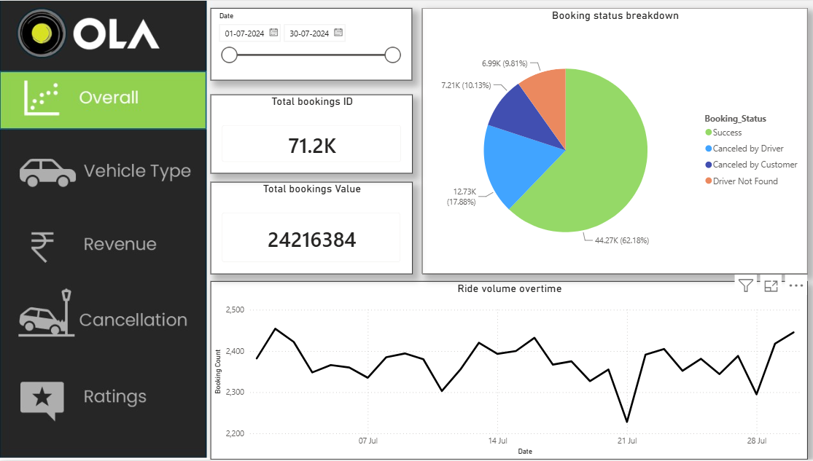
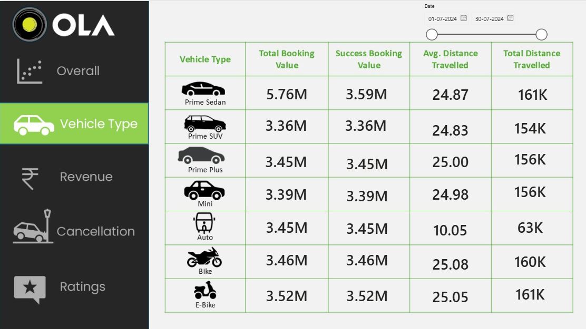
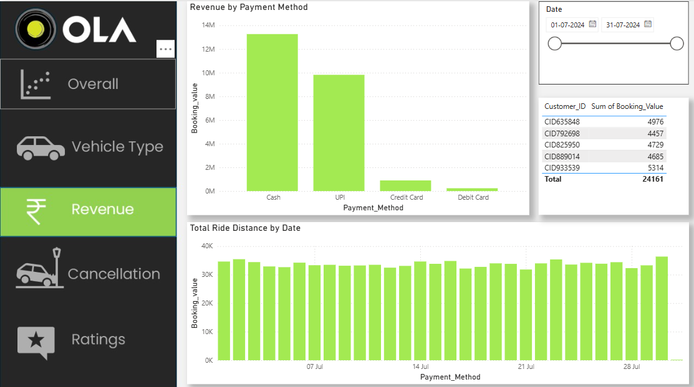
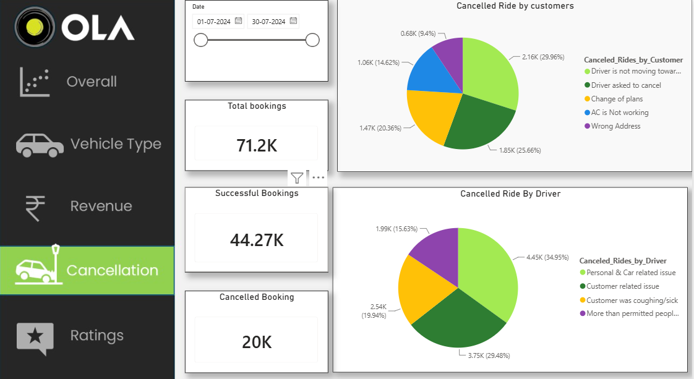
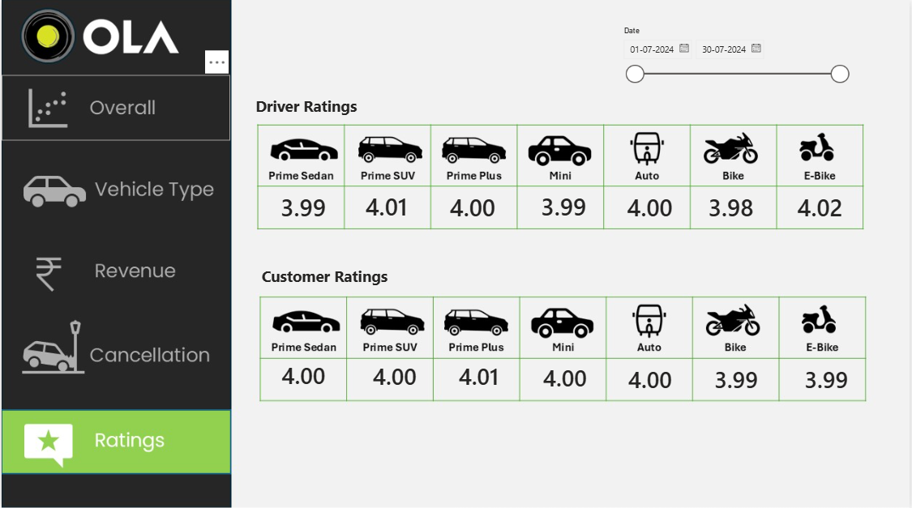

# Ola Ride Booking Data Analysis 🚖

## 📌 Project Overview
This project analyzes Ola ride booking data using Power BI to understand booking performance, revenue trends, vehicle types, cancellations, and customer and driver ratings.

## 🎯 Project Objectives
- Analyze total and successful bookings.
- Understand customer and driver cancellation reasons.
- Compare vehicle types and ride distances.
- Analyze booking value and payment methods.
- Evaluate customer and driver ratings.

## 🛠️ Tools & Technologies
- Microsoft Excel
- SQL
- Microsoft Power BI
- Power Query
- DAX

## 📊 Dashboard Pages
1. **Overall:** Booking performance and trends.
2. **Vehicle Type:** Vehicle-wise booking value and ride distance.
3. **Revenue:** Booking value by payment method and ride distance over time.
4. **Cancellation:** Booking cancellation metrics and reasons.
5. **Ratings:** Customer and driver ratings by vehicle type.

## 💡 Business Benefits
- Identify booking trends and demand patterns.
- Investigate cancellation reasons and potential service improvements.
- Compare vehicle categories to support operational planning.
- Monitor booking value and payment trends.
- Identify opportunities to improve customer experience.

## 📁 Dataset
The project uses Ola ride booking data for July 2024.

## 👨‍💻 Author
Aspiring Data Analyst | Excel | SQL | Power BI

## 📸 Dashboard Preview

### 1. Overall Dashboard

### 2. Vehicle Type Analysis

### 3. Revenue Analysis

### 4. Cancellation Analysis

### 5. Ratings Analysis

